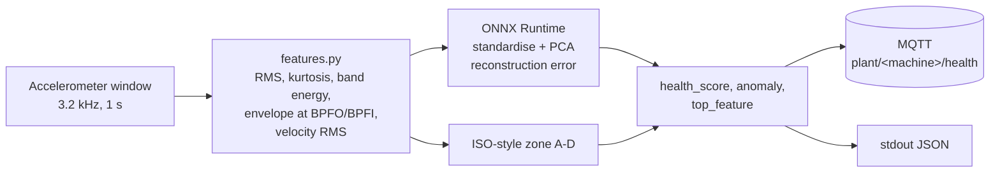

# vibration-edge-onnx

Predictive maintenance on a small edge device: take windows of accelerometer data
from a rotating machine, turn them into a few spectral features, score them with a
tiny anomaly model exported to **ONNX**, and publish a health score over **MQTT**
from a small container. It runs on x86-64 and is meant to run on ARM64
embedded Linux (a container on any ARM64 module) — the ARM64 part is **not yet tested**.

Why: a bearing that is starting to fail changes how a machine vibrates weeks before
it breaks. Doing the scoring next to the sensor means you ship a few bytes of
"health" instead of raw 3.2 kHz waveforms, and it keeps working when the network
does not.

All data here is **simulated**. See [Limits](#honest-limits).


<sub>Run-to-failure scenario (400 windows, fault onset at 200, seed 5) scored by the committed ONNX model. Simulated data.</sub>

## Architecture



- `sim/` simulates a machine: shaft 1x/2x, imbalance (1x grows), looseness
  (sub-harmonic and 3x-6x), bearing outer/inner race defects (impulse trains at
  BPFO/BPFI from the bearing geometry, ringing a 1.1 kHz resonance), noise, load
  and speed variation. Faults ramp up over a run-to-failure scenario.
- `features.py` computes 13 features per window, including the envelope spectrum
  (band-pass 600-1500 Hz, Hilbert transform via FFT) energy at BPFO and BPFI, and
  velocity RMS for an ISO 10816/20816-style zone label.
- `train.py` fits PCA on **healthy windows only**, sets the alarm threshold at the
  99th percentile of reconstruction error on separate healthy windows, and writes
  `models/vib_anomaly.onnx`. Standardisation, projection and thresholding are inside
  the ONNX graph (`onnx.helper`, 9 plain operators), so the edge needs only
  onnxruntime + numpy. The model file is 1.7 KB and is committed.
- `edge/infer.py` reads windows (simulator, CSV or stdin), prints JSON, optionally
  publishes to MQTT, and reports latency percentiles.

About the ISO zone: the boundaries (A/B 1.4, B/C 2.8, C/D 4.5 mm/s velocity RMS) are
**illustrative** values resembling those quoted for one machine class in the
ISO 10816 / ISO 20816 family. The real limits depend on machine class, foundation and
standard edition. Use the standard for your machine; this is not a compliance tool.

## Quickstart

```bash
python -m venv .venv && source .venv/bin/activate      # Windows: .venv\Scripts\activate
pip install -r requirements-dev.txt
python train.py                  # optional: the trained model is already committed
python -m edge.infer --sim       # 90 simulated windows, degradation starts at window 30
python -m pytest -q
```

Other inputs: `python -m edge.infer --csv windows.csv` (one window per row, 3200
comma-separated samples in m/s^2), or `... --csv -` from stdin. MQTT:
`--mqtt-host localhost [--machine pump-01]` publishes to `plant/pump-01/health`.

Container (needs Docker):

```bash
docker compose up --build        # edge-infer + mosquitto
mosquitto_sub -h localhost -t 'plant/+/health' -v
```

## Sample output

`python -m edge.infer --sim` (excerpt, window 0 / 29 / 33 / 55 / 89):

```json
{"ts": "2026-11-07T15:00:34.546+00:00", "machine": "pump-01", "health_score": 0.992, "anomaly": false, "iso_zone": "A", "top_feature": "log_env_bpfo"}
{"ts": "2026-11-07T15:00:34.702+00:00", "machine": "pump-01", "health_score": 0.997, "anomaly": false, "iso_zone": "A", "top_feature": "log_env_bpfi"}
{"ts": "2026-11-07T15:00:34.725+00:00", "machine": "pump-01", "health_score": 0.172, "anomaly": true, "iso_zone": "A", "top_feature": "log_band_800_1600"}
{"ts": "2026-11-07T15:00:34.869+00:00", "machine": "pump-01", "health_score": 0.0, "anomaly": true, "iso_zone": "C", "top_feature": "log_band_800_1600"}
{"ts": "2026-11-07T15:00:35.162+00:00", "machine": "pump-01", "health_score": 0.0, "anomaly": true, "iso_zone": "D", "top_feature": "rms"}
```

Note window 33: the model already flags the bearing defect while the overall
vibration level is still in zone A. That is the point of spectral features over a
plain overall-level alarm. `health_score = 1 / (1 + (error/threshold)^2)`, so 0.5
means "at the threshold". `top_feature` is the feature furthest from its healthy
mean (largest |z|), a hint and not a diagnosis.

## Measured numbers

From `pytest -s` (400-window run-to-failure, healthy for the first 200; seeds fixed;
all simulated):

| Metric | Value |
|---|---|
| False-positive rate, 500 held-out healthy windows | 1.0 % (threshold = p99 of healthy) |
| False-positive rate, 200 pre-onset windows of the run | 1.0 % |
| First 3-in-a-row alarm | window 215 (onset 200): 15 windows after onset |
| Lead time before end of run | 184 windows (about 3 min at 1 window/s) |
| Alarms in the last 50 windows | > 95 % (asserted in tests) |
| ONNX inference only, p50 / p95 | 0.18-0.20 ms / 0.22-0.26 ms |
| Features + inference per window, p50 / p95 | 2.7-2.8 ms / 3.3-3.8 ms |
| Model file | 1.7 KB |
| Docker image | 386 MB on disk, 93.7 MB compressed content (linux/amd64) |

Latency was measured on an x86-64 Windows laptop (Python 3.11, onnxruntime 1.31,
1 thread). **No ARM numbers yet.** The feature extraction (NumPy FFTs), not the
model, dominates. The model is deliberately tiny.

"Lead time" here is about the simulator's ramp, which I chose. It says the code
works end to end; it does not predict how early a real bearing would be caught.

## Honest limits

- **Simulated data only.** The simulator is physics-flavoured, not validated. A
  model trained and tested on the same generator will look better than it deserves.
- Not validated on real bearings. Next step: replay public run-to-failure and
  fault datasets, e.g. the **CWRU bearing data** and the **IMS (NASA) bearing
  dataset**, through `features.py` (set the bearing geometry and sample rate to
  match). I have not downloaded or used them here.
- PCA on 13 features is a baseline, not a state of the art. It is not robust to
  changing speed/load regimes beyond the mild variation simulated.
- ISO zones are illustrative; no standard compliance is claimed.
- MQTT demo config is anonymous and unencrypted. ARM64 deployment is an
  [unverified guide](docs/ARM64_DEPLOYMENT.md).

## Next steps

- Quantise to int8 (static quantisation with onnxruntime) once a bigger model justifies it.
- Run on an NPU/accelerator through the matching ONNX Runtime execution provider.
- Deploy updates as container image updates (OTA) with a registry and a rollback path.
- Real sensor driver (SPI/I2C MEMS or an ADC-sampled IEPE channel) in place of `--sim`.
- Evaluate on CWRU/IMS; add speed-tracking so features follow the shaft frequency.

## Layout

```
sim/            bearing.py (BPFO/BPFI), simulator.py (run-to-failure)
features.py     feature extraction + ISO-style zone
train.py        healthy-only PCA -> models/vib_anomaly.onnx
edge/infer.py   ONNX Runtime inference, stdout / MQTT, latency
tests/          pytest (formulas, features, ONNX parity, detection)
Dockerfile, docker-compose.yml, mosquitto/, docs/ARM64_DEPLOYMENT.md, scripts/post_figure.py
```

MIT licensed. This is an independent personal project; it is not affiliated with or
endorsed by any standards body.
